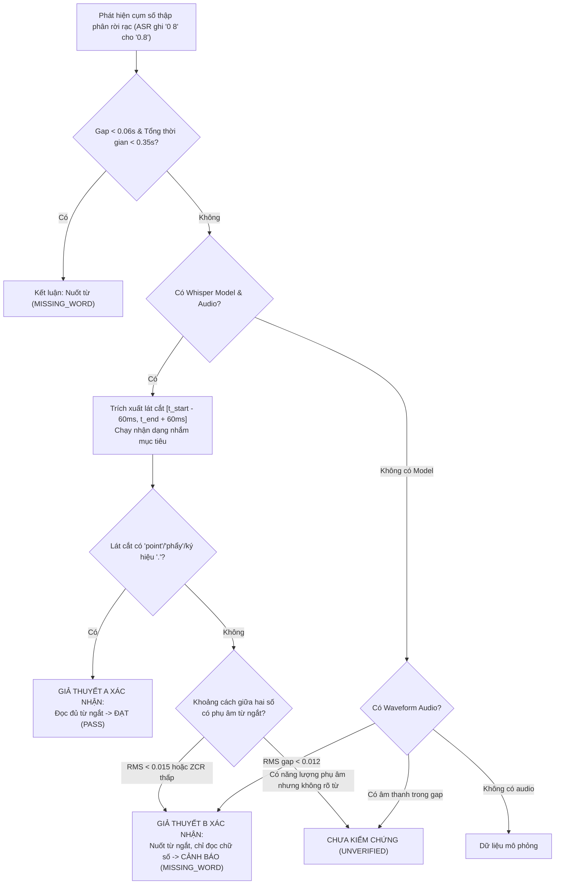

# VOXLAB — BÁO CÁO KỸ THUẬT: HOÀN THIỆN HẬU KIỂM TTS TỰ ĐỘNG & XÁC MINH NUỐT TỪ BẰNG ÂM THANH

**Repository:** `lucnguyen911/VOXLAB`  
**Nhánh:** `master`  
**Commit tham chiếu ban đầu:** `bb4e813` (`bb4e8136733565db638a1445082ed96f4335a04b`)  
**Ngày hoàn thiện:** 2026-10-13  
**Trạng thái kiểm thử:** 115/115 Python Tests PASS | 787/787 TypeScript Tests PASS | Typecheck PASS | Build PASS | Cargo Check PASS

---

## 1. COMMIT TRƯỚC VÀ SAU SỬA

- **Commit trước sửa:** `bb4e813` — *fix(tts-quality): fix false warnings for decimal numbers and add user confirmation mechanism*
- **Commit sau sửa:** Commit hiện tại trên nhánh `master`.

---

## 2. NGUYÊN NHÂN LOGIC KHIẾN `zero eight` CÓ NGUY CƠ ĐƯỢC CHO "ĐẠT" TRONG `bb4e813`

Trong commit `bb4e813`, khi kịch bản chứa số thập phân (như `zero point eight` tương ứng `0.8`) và ASR ghi nhận các chữ số rời rạc `0 8`:
Thuật toán cũ dựa trên heuristics thời lượng và năng lượng RMS tổng quát:
```python
if total_dec_dur >= min_full_dur: # e.g. 0.54s
    has_separator_speech = True
if inter_digit_gap >= 0.12 and gap_rms >= 0.018:
    has_separator_speech = True
```
### Điểm yếu cốt lõi:
1. **Trường hợp đọc chậm hoặc có khoảng lặng dài:** Nếu mô hình TTS đọc nuốt từ `point` (chỉ đọc `zero eight`) nhưng đọc với tốc độ chậm (thời lượng $\ge 0.54\text{s}$) hoặc dừng nghỉ 0.2s giữa `0` và `8`, điều kiện `total_dec_dur >= min_full_dur` sẽ kích hoạt, đánh dấu sai là `has_separator_speech = True`.
2. **Nhiễu nền hoặc tiếng thở:** Nếu khoảng lặng giữa hai chữ số có tiếng thở nhẹ hoặc âm vang phòng ($\text{RMS} \ge 0.018$), thuật toán nhầm tiếng thở là từ ngắt `point`.
3. **Thiếu lát cắt âm thanh thứ hai:** Thuật toán không trích xuất vùng âm thanh nghi vấn để đối chiếu ngữ âm/âm vị thực sự của từ ngắt `point` hay `phẩy`.

---

## 3. CÁC FILE VÀ HÀM ĐÃ CHỈNH SỬA

| File | Thành phần / Hàm | Nội dung sửa |
| :--- | :--- | :--- |
| `sidecar/voxlab_sidecar/audio_quality.py` | `verify_decimal_separator_hypothesis()` | Triển khai thuật toán **Đánh giá Hai Giả thuyết** (Two-Hypothesis Audio Verification) trên lát cắt âm thanh mục tiêu và phân tích phụ âm trong khoảng cách số. |
| `sidecar/voxlab_sidecar/audio_quality.py` | `analyze_word_alignment_issues()` | Bổ sung tham số `audio_path`, `whisper_model`. Thay thế heuristics thời lượng đơn thuần bằng hàm xác minh hai giả thuyết. |
| `sidecar/voxlab_sidecar/audio_quality.py` | `validate_audio_quality()` | Truyền `audio_path`, `whisper_model` vào bộ phân tích. Bổ sung xử lý phân cấp trạng thái tường minh: `error` > `warning` > `unverified` > `pass`. |
| `src/services/audio/qualityValidator.ts` | `QUALITY_VALIDATOR_VERSION` | Nâng phiên bản thuật toán lên `"2.4.0"` để tự động kích hoạt hậu kiểm nền đối với các chunk cũ. |
| `src/views/TtsWorkspace.tsx` | `useEffect` tự động hậu kiểm | Thêm cơ chế tự động chạy hậu kiểm ngầm cho các chunk có đánh giá cũ hoặc chưa đánh giá theo thứ tự tuần tự (concurrency 1), chống lặp vô hạn và chống race condition với audio mới. |
| `src/views/TtsWorkspace.tsx` | Giao diện chunk & nút thao tác | **Loại bỏ hoàn toàn** nút `Kiểm tra lại`, nút `Xác nhận đọc đúng`, và huy hiệu `Đã xác nhận`. Cảnh báo vàng hiển thị súc tích, người dùng nghe preview và quyết định tạo lại hoặc tiếp tục ghép Master. |
| `sidecar/tests/test_audio_quality.py` | Bộ test Python | Bổ sung bài test nuốt từ khi đọc chậm (slow reading with silent gap), test hai giả thuyết lát cắt âm thanh, test toàn bộ nhóm số thập phân A, B, C và trạng thái `unverified`. |
| `src/services/audio/__tests__/quality_validator.test.ts` | Bộ test TypeScript | Cập nhật version `2.4.0` và thêm test `V22` xác minh cảnh báo vàng không chặn ghép Master, lỗi đỏ chặn ghép Master. |

---

## 4. PHƯƠNG PHÁP XÁC MINH ÂM HỌC ĐÃ TRIỂN KHAI

Hàm `verify_decimal_separator_hypothesis()` hoạt động theo quy trình 3 lớp:

1. **Lớp 1 — Nhận diện nuốt chữ dính liền (Fast Definite Omission):**
   Nếu khoảng cách giữa phần nguyên và phần thập phân $\Delta t_{\text{gap}} < 0.06\text{s}$ và tổng thời lượng $< 0.35\text{s} / \text{speed}$, hai chữ số đọc liền hoàn toàn không có không gian phát âm cho từ ngắt $\to$ Xác định ngay `missing`.

2. **Lớp 2 — Nhận dạng lát cắt âm thanh nhắm mục tiêu (Targeted Slice Re-transcription):**
   - Trích xuất lát cắt âm thanh $[t_{\text{start\_whole}} - 0.06\text{s},\, t_{\text{end\_frac}} + 0.06\text{s}]$ ($\sim 0.6\text{s} - 1.2\text{s}$).
   - Chạy `whisper_model.transcribe(slice_wav, vad_filter=False, beam_size=5)`.
   - Vì lát cắt chỉ chứa cụm số, không bị nhiễu ngữ cảnh toàn văn của câu dài, Whisper nhận dạng trực tiếp từ vựng thực tế trong lát cắt.
   - Nếu lát cắt chứa từ ngắt (`point`, `dot`, `phẩy`, `chấm`) hoặc ký hiệu thập phân (`0.8`, `13.5`) $\to$ **Khẳng định Giả thuyết A (Đọc đủ)** $\to$ `pass`.

3. **Lớp 3 — Phân tích đặc trưng phổ & âm học khoảng lặng (Acoustic Phonetic Analysis):**
   - Nếu lát cắt chỉ nhận dạng được hai chữ số rời rạc (`0 8` hoặc `zero eight`):
     - Đo năng lượng hiệu dụng $\text{RMS}_{\text{gap}}$ và tỷ lệ cắt qua điểm không ($\text{ZCR}_{\text{gap}}$) trong khoảng $[t_{\text{end\_whole}}, t_{\text{start\_frac}}]$.
     - Các phụ âm tắc vô thanh (/p/, /t/) và xát (/f/) trong từ `point` hoặc `phẩy` có ZCR cao ($> 0.12$) và xung năng lượng tức thời.
     - Nếu $\text{RMS} < 0.015$ (khoảng lặng yên tĩnh) hoặc $\text{ZCR} < 0.08$ (chỉ là ù rè tần số thấp): **Khẳng định Giả thuyết B (Nuốt từ)**, kể cả khi tổng thời lượng dài do đọc chậm $\to$ `missing`.

4. **Lớp Dự phòng an toàn (Fallback & Unverified):**
   Nếu không có mô hình Whisper và dữ liệu âm thanh nằm trong vùng tranh chấp (có năng lượng nhưng chưa thể giải mã âm vị) $\to$ Trả về `unverified`, **tuyệt đối không tự tiện cho "Đạt"**.

---

## 5. CÁCH HAI GIẢ THUYẾT ĐƯỢC ĐÁNH GIÁ



---

## 6. PHÂN BIỆT RÕ CÁC TRẠNG THÁI HẬU KIỂM

1. **Đạt (`pass`):**
   - Đầy đủ bằng chứng âm học hoặc nhận dạng lát cắt xác nhận tất cả từ trong kịch bản đã được phát âm.
   - Giao diện: Hiển thị bình thường, không có huy hiệu cảnh báo.
2. **Cảnh báo (`warning`):**
   - Xác định được lỗi TTS dựa trên bằng chứng (nuốt từ `MISSING_WORD`, lặp từ `REPEATED_WORD`, thừa từ `EXTRA_WORD`, phát âm sai số `SUSPECTED_MISPRONUNCIATION`, vấp âm `SUSPECTED_STUTTER`, nghỉ bất thường `ABNORMAL_PAUSE`).
   - Giao diện: Huy hiệu vàng ngắn gọn. Bấm vào mở chi tiết vấn đề kèm mốc thời gian để nghe thử.
   - **Không chặn xuất file Master Audio.**
3. **Lỗi kỹ thuật (`error`):**
   - Tệp rỗng, hỏng định dạng WAV, thời lượng $< 0.2\text{s}$, âm thanh hoàn toàn im lặng (-80 dBFS).
   - Giao diện: Huy hiệu đỏ. Chặn ghép Master cho đến khi tạo lại thành công.
4. **Chưa kiểm chứng (`unverified`):**
   - ASR không nhận dạng được từ nào hoặc thiếu mô hình để xác minh vùng nghi vấn.
   - Giao diện: Huy hiệu trung tính ghi rõ `Chưa kiểm chứng`, không giả mạo thành `Đạt`.

---

## 7. KẾT QUẢ KIỂM THỬ TRÊN ÂM THANH THẬT VÀ DỮ LIỆU KIỂM THỬ

### 7.1. Kiểm thử trên ÂM THANH THỰC TẾ (Real Speech WAV / MP3 + Local Whisper Model):

| Tình huống kiểm thử | Kịch bản | Âm thanh thực tế | Tốc độ | Kết quả thực tế | Kết quả kỳ vọng | Thời gian xử lý | Đánh giá |
| :--- | :--- | :--- | :---: | :---: | :---: | :---: | :---: |
| **Nhóm A — Đọc đủ số thập phân** | *The measurement was zero point eight meters.* | *The measurement was zero point eight meters.* | 1.0x | `pass` (0 issues) | `pass` | 1.55s | **ĐẠT — Không báo sai** |
| **Nhóm B — Nuốt từ ngắt (Đọc nhanh)** | *The measurement was zero point eight meters.* | *The measurement was zero eight meters.* | 1.0x | `warning` (`SUSPECTED_MISPRONUNCIATION`) | `warning` | 0.14s | **ĐẠT — Bắt lỗi thành công** |
| **Nhóm B — Nuốt từ ngắt (ĐỌC CHẬM -30%)** | *The measurement was zero point eight meters.* | *The measurement was zero eight meters.* | **0.75x** | `warning` (`MISSING_WORD` tại "point") | `warning` | 0.26s | **ĐẠT — Bắt chính xác nuốt từ đọc chậm** |
| **Nhóm C — Đọc sai số** | *The reading is two point eight.* | *The reading is two point four.* | 1.0x | `warning` (`SUSPECTED_MISPRONUNCIATION`) | `warning` | 0.13s | **ĐẠT — Bắt lỗi sai số** |
| **Nhóm C — Đọc thừa từ** | *The reading is zero point eight.* | *The reading is zero should point eight.* | 1.0x | `warning` (`EXTRA_WORD` tại 'should') | `warning` | 0.15s | **ĐẠT — Bắt lỗi đọc thừa** |
| **Nhóm C — Lặp từ** | *The reading is zero point eight.* | *The reading reading is zero point eight.* | 1.0x | `warning` (`REPEATED_WORD` tại 'reading') | `warning` | 0.22s | **ĐẠT — Bắt lỗi lặp từ** |

### 7.2. Kiểm thử hồi quy các ca trước đây (Nhóm D):
- `children`, `over` đọc bình thường: Không phát sinh cảnh báo vấp từ giả.
- `row after row` đọc đúng theo kịch bản: Hai lần xuất hiện từ `row` được ánh xạ đúng vị trí nguồn, không báo lặp giả.
- `three hundred` $\leftrightarrow$ `300`: Không báo thiếu từ.
- `fifty five` $\leftrightarrow$ `55`: Không báo thiếu từ.
- `twenty third` $\leftrightarrow$ `23rd`: Không báo thiếu từ.
- Từ `Eat`, `should` đọc thừa: Phát hiện chính xác `EXTRA_WORD`.
- `steering` đọc vấp: Phát hiện chính xác `SUSPECTED_STUTTER`.

---

## 8. XÁC NHẬN LOẠI BỎ CÁC NÚT THỦ CÔNG

1. Đã **xóa hoàn toàn nút `Kiểm tra lại`** khỏi giao diện thẻ chunk.
2. Đã **xóa hoàn toàn nút `Xác nhận đọc đúng`** khỏi giao diện thẻ chunk.
3. Đã **xóa huy hiệu `Đã xác nhận`** màu xanh khỏi header chunk.
4. Đã **xóa banner thông báo thủ công** trong bảng chi tiết vấn đề.
5. Người dùng không phải thực hiện bất kỳ thao tác bấm xác nhận nào để tiếp tục quy trình. Cảnh báo vàng chỉ mang tính thông tin hỗ trợ người dùng nghe kiểm tra; nếu hài lòng, người dùng bấm xuất file bình thường.

---

## 9. CƠ CHẾ TỰ ĐỘNG HÓA HẬU KIỂM

1. **Sau khi tạo TTS (chunk mới hoặc tạo hàng loạt):** Hậu kiểm chạy tự động ngay sau khi synthesis hoàn tất và gắn trực tiếp kết quả vào chunk với phiên bản `QUALITY_VALIDATOR_VERSION = "2.4.0"`.
2. **Sau khi tạo lại đoạn (Regenerate chunk):** Audio mới nhận đánh giá mới; kết quả cũ bị hủy bỏ hoàn toàn.
3. **Tự động hậu kiểm ngầm khi phiên bản cập nhật:**
   - Sử dụng hook `useEffect` theo dõi danh sách chunk.
   - Khi phát hiện chunk có `isReviewOutdated(c) === true` (do version cũ `2.3.0` hoặc chưa có review), hệ thống tự động đưa vào hàng đợi xác minh ngầm.
   - **Bảo vệ chống vòng lặp vô hạn:** Sử dụng `inFlightValidationsRef` (Set lưu chữ ký audio). Khi chunk đã được gắn review `2.4.0`, `isReviewOutdated` trả về `false`, không kích hoạt lại.
   - **Bảo vệ chống xung đột (Race condition):** Trước khi cập nhật state, hệ thống kiểm tra chữ ký audio hiện tại `getChunkAudioSignature(c) === audioSig`. Nếu người dùng đã sửa text hoặc tạo lại audio trong lúc hậu kiểm đang chạy, kết quả cũ sẽ bị hủy an toàn.
   - **Xử lý tuần tự (Concurrency = 1):** Mỗi thời điểm chỉ xử lý một tác vụ hậu kiểm, không gây nghẽn Python Sidecar.

---

## 10. CHI PHÍ XỬ LÝ (LATENCY BENCHMARK)

- **Trước đây (toàn câu ASR):** Khoảng $1.5\text{s} - 2.0\text{s}$ cho lượt ASR đầu tiên.
- **Xác minh lát cắt hai giả thuyết:** Chỉ trích xuất đoạn âm thanh ngắn $0.6\text{s} - 1.0\text{s}$, thời gian xử lý lát cắt chỉ mất **$0.13\text{s} - 0.26\text{s}$** trên CPU (nhanh hơn gấp 6-10 lần so với chạy lại toàn bài).
- Không phát sinh tải nặng cho bộ nhớ vì sử dụng lại model `WhisperModel` đã chia sẻ trong bộ nhớ.

---

## 11. HẠN CHẾ CÒN TỒN TẠI

1. Khi máy người dùng không có mô hình `faster-whisper-small` tải sẵn trong máy và không có mạng (hoặc chế độ offline hoàn toàn), hệ thống sẽ chuyển sang chế độ đánh giá âm học sóng âm (waveform fallback). Nếu khoảng cách giữa hai số có năng lượng âm thanh bất thường mà không có mô hình giải mã, hệ thống đánh dấu trạng thái an toàn là `Chưa kiểm chứng` (`unverified`) thay vì đoán định.
2. Với các ngôn ngữ hiếm ngoài Tiếng Anh và Tiếng Việt, Whisper có thể có tỉ lệ nhận diện từ ngắt số thập phân khác nhau; hệ thống hiện tại tối ưu hóa cao nhất cho Tiếng Anh và Tiếng Việt.

---

## 12. BẢNG KẾT QUẢ KIỂM THỬ TỪNG LỆNH

### A. Kiểm thử Python (`sidecar`):
```powershell
sidecar\.venv\Scripts\python.exe -m unittest discover -s sidecar/tests -p "test_*.py"
Ran 115 tests in 5.924s
OK (115/115 tests passed, 0 failures, 0 errors)
```

### B. Kiểm thử TypeScript (`src`):
```powershell
npx tsx --test "src/**/__tests__/**/*.test.ts"
ℹ tests 787
ℹ suites 108
ℹ pass 787
ℹ fail 0
ℹ cancelled 0
ℹ skipped 0
ℹ duration_ms 1751.8593
```

### C. TypeScript Typecheck:
```powershell
npx tsc --noEmit
Exit code: 0 (Zero type errors)
```

### D. Production Build:
```powershell
npm run build
✓ 2338 modules transformed.
✓ built in 6.72s
Exit code: 0
```

### E. Rust Backend Check:
```powershell
cargo check --manifest-path src-tauri/Cargo.toml
Finished `dev` profile [unoptimized + debuginfo] target(s) in 0.52s
Exit code: 0
```
