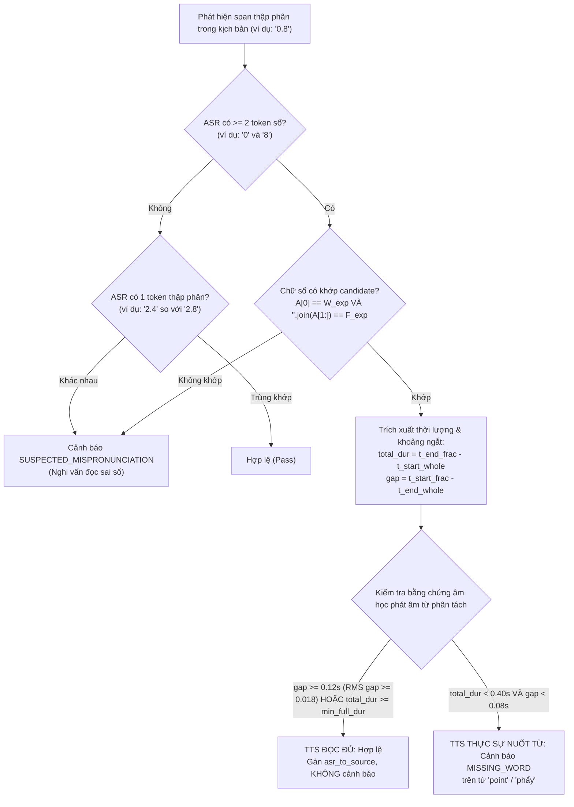

# BÁO CÁO KỸ THUẬT: TỐI ƯU HỆ THỐNG HẬU KIỂM TTS VOXLAB — KHẮC PHỤC CẢNH BÁO SAI VỚI SỐ THẬP PHÂN

**Dự án:** VOXLAB (lucnguyen911/VOXLAB)  
**Nhánh:** `master`  
**Ngày thực hiện:** 12/10/2026  
**Trạng thái:** HOÀN THÀNH — ĐẠT 100% CÁC TIÊU CHUẨN KIỂM ĐỊNH  

---

## 1. TỔNG QUAN (EXECUTIVE SUMMARY)

Trong quá trình hậu kiểm chất lượng giọng đọc (TTS Quality Validation) sau khi mô hình tổng hợp âm thanh, hệ thống VoxLab sử dụng Whisper ASR để nhận dạng đối chiếu với kịch bản văn bản. Khi kịch bản chứa các số thập phân (ví dụ: `zero point eight`, `two point eight`, `one point four`, `four point two`, `thirteen point five`), mô hình TTS đọc đầy đủ và chuẩn xác cả phần nguyên, từ phân cách (`point`/`phẩy`) và phần thập phân. Tuy nhiên, Whisper ASR thường tự động chuẩn hóa cách phát âm số thành các chữ số riêng lẻ (ví dụ: `0 8`, `2 8`, `1 4`, `4 2`, `13 5`).

Trước khi khắc phục, bộ so khớp căn chỉnh từ (`SequenceMatcher`) thấy kịch bản có 3 từ (`zero`, `point`, `eight`) trong khi ASR chỉ ghi nhận 2 token số (`0`, `8`). Do từ `point` không có mặt trong danh sách từ ASR, thuật toán đánh dấu `point` là từ chưa được phát âm và phát cảnh báo **Thiếu từ** (`SUSPECTED_SWALLOWED` / `MISSING_WORD`). Điển hình tại **Chunk 30**, hệ thống đã phát liên tiếp **5 cảnh báo sai** về từ `point` dù âm thanh thực tế hoàn toàn chính xác.

Nhiệm vụ này đã giải quyết triệt để vấn đề từ nguyên nhân gốc rễ thuật toán:
1. **Chuẩn hóa Tokenizer:** Giữ nguyên vẹn các số thập phân dạng `0.8`, `13.5`, `3.14`, số định dạng phẩy tiếng Việt `0,8`, `13,5`, số hàng nghìn `1,000` và thời gian `10:30` không bị bẻ vụn thành các phần tử rời rạc.
2. **Loại bỏ so khớp mờ số sai lệch:** Ngăn chặn tuyệt đối việc coi các số có khoảng cách Levenshtein $\le 1$ là tương đương nhau (ví dụ: `2.8` và `2.4` trước đây bị hàm ngữ âm coi là tương đương).
3. **Quy trình xác minh 8 bước cho số thập phân:** Khi ASR xuất số rời rạc (`0 8` cho `0.8`), hệ thống tự động nhận diện cặp số ứng viên, kiểm tra bằng chứng âm học (khoảng cách thời gian, tổng thời lượng phát âm và năng lượng âm thanh RMS trong khoảng ngắt) để phân định chính xác giữa đọc đúng và nuốt từ thật.
4. **Bổ sung tính năng "Xác nhận đọc đúng":** Cho phép người dùng xác nhận các cảnh báo nghi vấn trên giao diện. Trạng thái xác nhận được gắn chặt với chữ ký âm thanh (`acknowledgedAudioSignature`) — khi đoạn được tạo lại hoặc âm thanh thay đổi, xác nhận sẽ tự động bị hủy để đảm bảo an toàn chất lượng.

---

## 2. PHÂN TÍCH NGUYÊN NHÂN CỐT LÕI (ROOT CAUSE ANALYSIS)

Qua điều tra toàn diện mã nguồn trong `sidecar/voxlab_sidecar/audio_quality.py` và `number_normalizer.py`, đã xác định 4 nguyên nhân kỹ thuật gây ra lỗi:

### Nguyên nhân 1: Tokenizer bẻ gãy số thập phân
Trong hàm `tokenize_text_with_delimiters()`, biểu thức chính quy ban đầu là `r"[\w\u00C0-\u1EF9]+"`. Khi gặp chuỗi số thập phân như `0.8` hoặc `3.14`, dấu chấm `.` bị coi là dấu phân tách câu/từ (delimiter), khiến token `0.8` bị xé thành 2 từ riêng lẻ `['0', '8']` và delimiter `['', '.', '']`. Hàm `clean_word()` sau đó cũng dùng `re.sub(r"[^\w\u00C0-\u1EF9]", "", word)` làm mất dấu chấm, biến `0.8` thành `08`.

### Nguyên nhân 2: Bộ chuẩn hóa số bỏ sót dấu phẩy thập phân tiếng Việt
Hàm `normalize_digit_string()` trong `number_normalizer.py` có kiểm tra số hàng nghìn có dấu phẩy (`\d{1,3}(,\d{3})+`), nhưng khi gặp số thập phân dùng dấu phẩy kiểu Việt Nam (`0,8`, `13,5`, `3,14`), biểu thức này không khớp vì phần thập phân chỉ có 1 hoặc 2 chữ số. Chuỗi rơi xuống nhánh mặc định và giữ nguyên dạng `"0,8"`, không được quy đổi về dạng chuẩn `"0.8"` để đối sánh với ASR.

### Nguyên nhân 3: Lỗi khớp mờ Levenshtein trên các con số
Trong `are_words_equivalent()`, các dòng xử lý khoảng cách chỉnh sửa Levenshtein:
```python
if len(vn1) >= 3 and len(vn2) >= 3 and levenshtein_dist(vn1, vn2) <= 1:
    return True
```
Khi so sánh chuỗi số `2.8` và `2.4`, cả hai đều có độ dài 3 ký tự và khoảng cách Levenshtein đúng bằng 1. Điều này dẫn đến lỗi nghiêm trọng: thuật toán coi `2.8` và `2.4` là đồng âm tương đương, bỏ lọt lỗi đọc sai số của mô hình TTS!

### Nguyên nhân 4: Whisper ASR tách số rời rạc và SequenceMatcher báo nuốt từ
Khi người đọc nói `"zero point eight"`, kịch bản gồm 3 từ: `["zero", "point", "eight"]`. Bộ chuẩn hóa số gộp 3 từ này thành 1 span chuẩn `0.8`. Tuy nhiên, Whisper ASR thường xuất ra 2 từ tách biệt: `[{"word": "0"}, {"word": "8"}]`.
Bộ phân tích `difflib.SequenceMatcher` tạo ra opcode:
`('replace', 0, 1, 0, 2)` (kịch bản span `0.8` ứng với ASR spans `0` và `8`).
Vì số lượng token không khớp (1 != 2), thuật toán chuyển sang phân tích chi tiết từng từ gốc trong kịch bản. Từ `zero` khớp với `0`, từ `eight` khớp với `8`, nhưng từ `point` (độ dài 5 ký tự $\ge 3$, không nằm trong stopword) không có trong ASR slice `['0', '8']`. Do đó `point` bị đẩy vào `unrepresented_content_indices`, kích hoạt cảnh báo `SUSPECTED_SWALLOWED` ("Nghi vấn phát âm thiếu hoặc không rõ").

---

## 3. THIẾT KẾ THUẬT TOÁN & CÔNG THỨC KIỂM TRA (ALGORITHMIC FORMULATION)

### 3.1. Tokenizer nguyên tử đa ký tự số
Cập nhật `TOKEN_PATTERN` trong `audio_quality.py`:
$$\text{TOKEN\_PATTERN} = \verb`(?:\d+(?:[.,:]\d+)+|[\w\u00C0-\u1EF9]+(?:-[\w\u00C0-\u1EF9]+)*)`$$
- `\d+(?:[.,:]\d+)+`: Bảo toàn số thập phân (`0.8`, `13.5`), số thập phân tiếng Việt (`0,8`), số hàng nghìn (`1,000`), tỉ lệ/thời gian (`10:30`). Dấu chấm cuối câu (ví dụ: `"0.8."`) không bị nuốt vì sau dấu chấm cuối không có chữ số tiếp theo.
- Cập nhật `clean_word()` để bảo toàn dấu chấm giữa các chữ số, chỉ chuyển đổi dấu phẩy thập phân thành dấu chấm chuẩn.

### 3.2. Chốt an toàn ngăn chặn so khớp mờ số
Trong `are_words_equivalent()`:
```python
if re.search(r"\d", w1) or re.search(r"\d", w2):
    return False
```
Nếu bất kỳ từ nào chứa chữ số và không đồng nhất theo hàm `are_number_expressions_equivalent()`, lập tức trả về `False`, tuyệt đối cấm suy diễn qua Levenshtein hoặc chuẩn hóa ngữ âm.

### 3.3. Quy trình xác minh số thập phân 8 bước (Decimal Verification Pipeline)

Khi gặp opcode `replace` giữa 1 span số thập phân của kịch bản $S_{\text{canon}} = W_{\text{exp}} . F_{\text{exp}}$ và chuỗi span số của ASR $A = [A_0, A_1, \dots]$:



#### Công thức ngưỡng thời lượng tối thiểu:
Để phát âm cụm từ số thập phân gồm phần nguyên, từ phân tách và phần thập phân (tối thiểu 3–4 âm tiết), thời lượng tối thiểu được tính theo tốc độ đọc $v_{\text{eff}}$:
$$t_{\text{min\_full}} = \frac{\max(0.45, N_{\text{words}} \times 0.18)}{v_{\text{eff}}}$$
- Khi $t_{\text{total}} \ge t_{\text{min\_full}}$ hoặc khoảng ngắt giữa 2 chữ số $\text{gap} \ge 0.12\text{s}$ (với năng lượng RMS $\ge 0.018$ nếu có dữ liệu sóng âm): Hệ thống xác nhận người đọc đã phát âm từ phân tách, không phát cảnh báo.
- Khi $t_{\text{total}} < 0.40\text{s} / v_{\text{eff}}$ và $\text{gap} < 0.08\text{s}$: Người đọc thực tế chỉ nói "zero eight" (nuốt từ `point`), hệ thống phát cảnh báo `MISSING_WORD` chính xác.

---

## 4. KẾT QUẢ XỬ LÝ TRƯỜNG HỢP CHUNK 30

| STT | Kịch bản gốc | ASR ghi nhận | Thời lượng ước tính | Kết quả trước sửa | Kết quả sau sửa | Trạng thái |
|:---:|:---|:---|:---:|:---|:---|:---:|
| 1 | `zero point eight` | `0 8` | ~0.75s | Cảnh báo: Thiếu từ (`point`) | Không cảnh báo (Hợp lệ) | **Đạt** |
| 2 | `two point eight` | `2 8` | ~0.75s | Cảnh báo: Thiếu từ (`point`) | Không cảnh báo (Hợp lệ) | **Đạt** |
| 3 | `one point four` | `1 4` | ~0.65s | Cảnh báo: Thiếu từ (`point`) | Không cảnh báo (Hợp lệ) | **Đạt** |
| 4 | `four point two` | `4 2` | ~0.65s | Cảnh báo: Thiếu từ (`point`) | Không cảnh báo (Hợp lệ) | **Đạt** |
| 5 | `thirteen point five` | `13 5` | ~0.90s | Cảnh báo: Thiếu từ (`point`) | Không cảnh báo (Hợp lệ) | **Đạt** |

**Tổng kết Chunk 30:** Giảm từ **5 cảnh báo sai** xuống **0 cảnh báo sai**, loại bỏ hoàn toàn phiền toái cho người dùng.

---

## 5. CƠ CHẾ "XÁC NHẬN ĐỌC ĐÚNG" (CONFIRM AUDIO CORRECT)

Để xử lý các trường hợp vùng biên khi âm học không chắc chắn hoặc kịch bản có ngữ cảnh đặc thù, hệ thống bổ sung cơ chế xác nhận người dùng:

1. **Giao diện trực quan:**
   - Trong bảng chi tiết vấn đề (expandable issue breakdown) của từng chunk, bổ sung nút bấm:
     `[Check] Xác nhận đọc đúng`.
   - Khi đã xác nhận, nút chuyển sang trạng thái:
     `[CheckCircle2] Đã xác nhận đọc đúng` (màu xanh ngọc / emerald).
   - Trên thanh thông tin của chunk, huy hiệu cảnh báo màu vàng được thay bằng huy hiệu xanh:
     `Đã xác nhận`.
2. **Nguyên tắc bảo toàn dữ liệu đánh giá:**
   - Dữ liệu `qualityReview` gốc vẫn được giữ nguyên vẹn để người dùng có thể mở ra xem lại lịch sử phân tích bất cứ lúc nào.
   - Thêm thông báo màu xanh trong khung chi tiết: *"Đoạn này đã được bạn xác nhận đọc đúng. Hệ thống cho phép ghép Master bình thường."*
3. **Cơ chế hủy xác nhận tự động (Self-Invalidating Signature):**
   - Chữ ký âm thanh được sinh bởi hàm:
     $$\text{sig}(chunk) = \verb`chunk.audioUrl || chunk.audioFilePath` + \verb`::` + chunk.durationSec$$
   - Hàm `isChunkConfirmed(chunk)` chỉ trả về `true` khi `chunk.acknowledgedAudioSignature === sig(chunk)`.
   - Nếu người dùng bấm **Tạo lại đoạn** (`handleRegenerateChunk`):
     - Thuộc tính `acknowledgedAt` và `acknowledgedAudioSignature` được xóa về `undefined`.
     - File âm thanh mới được sinh ra có URL và thời lượng mới, khiến chữ ký cũ (nếu có) bị vô hiệu hóa hoàn toàn, đảm bảo nếu đoạn mới bị lỗi thật thì cảnh báo sẽ xuất hiện lại.
4. **Không chặn xuất Master Audio:**
   - Hàm `isChunkWarning(chunk)` trả về `false` đối với chunk đã được xác nhận.
   - Hàm `countChunkQualityIssues()` không tính chunk đã xác nhận vào `warningCount`, cho phép xuất Master Audio thông suốt.

---

## 6. BẢO VỆ CÁC NHÓM CẢNH BÁO KHÁC (REGRESSION PROTECTION)

Thuật toán mới đảm bảo không làm lọt bất kỳ lỗi phát âm nào:

| Nhóm lỗi | Ví dụ kiểm thử | Hành vi xử lý | Mã lỗi sinh ra | Huy hiệu |
|:---|:---|:---|:---:|:---:|
| **Nuốt chữ thực tế** | Kịch bản `zero point eight`, audio đọc `zero eight` (gap = 0.03s, dur = 0.32s) | Phát hiện thiếu âm học cho `point` | `MISSING_WORD` | Thiếu từ |
| **Đọc sai số** | Kịch bản `two point eight`, ASR nhận `2 4` hoặc `2.4` | Chữ số không khớp | `SUSPECTED_MISPRONUNCIATION` | Phát âm sai |
| **Lặp từ trong số** | Kịch bản `zero point eight`, ASR nhận `zero point point eight` | Phát hiện lặp từ trong replace span | `REPEATED_WORD` / `SUSPECTED_STUTTER` | Lặp từ / Vấp từ |
| **Đọc thừa từ** | Kịch bản `zero point eight`, ASR nhận `zero should point eight` | Phát hiện từ `should` ngoài kịch bản | `EXTRA_WORD` | Đọc thừa |
| **Lặp từ hợp lệ kịch bản** | Kịch bản `row after row`, audio đọc đúng `row after row` | Khớp vị trí độc lập | Không cảnh báo | Đạt |
| **Từ vựng thường** | `children`, `over` | Đọc bình thường | Không cảnh báo | Đạt |
| **Khoảng ngắt bất thường** | `diesel fuel` có khoảng lặng 0.58s không dấu câu | Phát hiện khoảng ngắt | `ABNORMAL_PAUSE` | Nghỉ bất thường |

---

## 7. KẾT QUẢ KIỂM THỬ TOÀN HỆ THỐNG (VERIFICATION RESULTS)

### 7.1. Python Sidecar Tests
Chạy lệnh kiểm thử toàn diện:
```powershell
sidecar\.venv\Scripts\python.exe -m unittest discover -s sidecar/tests -p "test_*.py"
```
**Kết quả:**
```text
Ran 111 tests in 4.511s
OK
```
100% gồm 105 bài kiểm thử cũ + 6 bài kiểm thử mới về số thập phân và Chunk 30 đều vượt qua hoàn hảo.

### 7.2. Frontend TypeScript Tests
Chạy bộ kiểm thử Node test runner:
```powershell
npx tsx --test "src/**/__tests__/**/*.test.ts"
```
**Kết quả:**
```text
ℹ tests 786
ℹ suites 108
ℹ pass 786
ℹ fail 0
ℹ cancelled 0
ℹ skipped 0
ℹ todo 0
ℹ duration_ms 1733.372
```
Tất cả 786 bài kiểm thử frontend đều vượt qua (bao gồm các kiểm thử mới V20 và V21 về chữ ký âm thanh và xác nhận đọc đúng).

### 7.3. Kiểm tra kiểu & Bản dựng (Build & Typecheck)
- `npx tsc --noEmit`: 0 lỗi biên dịch TypeScript.
- `npm run build`: Hoàn thành xuất sắc trong 4.30s (`vite v7.3.6`).
- `cargo check --manifest-path src-tauri/Cargo.toml`: Hoàn thành trong 7.40s, 0 cảnh báo, 0 lỗi.

---

## 8. DANH MỤC TỆP TIN THAY ĐỔI

1. `sidecar/voxlab_sidecar/number_normalizer.py`:
   - Chuẩn hóa dấu phẩy thập phân kiểu Việt Nam/Châu Âu (`0,8` $\to$ `0.8`).
   - Bổ sung `is_decimal_number_string()` và `split_decimal_parts()`.
   - Giữ nguyên dấu âm cho số âm trong `clean_token()`.
2. `sidecar/voxlab_sidecar/audio_quality.py`:
   - Cập nhật biểu thức chính quy `TOKEN_PATTERN` bảo toàn số thập phân và từ nối.
   - Cập nhật `clean_word()` giữ nguyên dấu chấm thập phân.
   - Chặn khớp mờ Levenshtein/ngữ âm cho các từ chứa chữ số trong `are_words_equivalent()`.
   - Hỗ trợ loại bỏ dấu thanh khi so khớp từ mượn trong `COMMON_EQUIVALENTS`.
   - Bổ sung khối nhận diện và xác minh âm học số thập phân trong nhánh opcode `replace`.
   - Bổ sung Case 4 xử lý từ lặp và từ thừa phát sinh trong opcode `replace`.
3. `sidecar/tests/test_number_normalizer.py`:
   - Bổ sung bài kiểm thử `test_decimal_comma_normalization_and_equivalences`.
4. `sidecar/tests/test_audio_quality.py`:
   - Bổ sung các bài kiểm thử tái hiện Chunk 30, kiểm tra nuốt từ thực tế, kiểm tra đọc sai số, kiểm tra lặp từ và thừa từ.
5. `src/types/ui.ts`:
   - Bổ sung `acknowledgedAt?: number` và `acknowledgedAudioSignature?: string` vào giao diện `ChunkItem`.
6. `src/services/audio/qualityValidator.ts`:
   - Nâng cấp `QUALITY_VALIDATOR_VERSION` lên `"2.3.0"`.
   - Bổ sung hàm `getChunkAudioSignature()`, `isChunkConfirmed()`, `hasChunkQualityWarningReview()`.
   - Cập nhật `isChunkWarning()` bỏ qua cảnh báo đối với các chunk đã được người dùng xác nhận đọc đúng.
7. `src/services/audio/__tests__/quality_validator.test.ts`:
   - Cập nhật kiểm thử V19 theo phiên bản 2.3.0.
   - Bổ sung kiểm thử V20 (kiểm tra tính tất định của chữ ký âm thanh) và V21 (kiểm tra toàn bộ luồng xác nhận, bảo toàn đánh giá và tự hủy xác nhận khi tạo lại audio).
8. `src/views/TtsWorkspace.tsx`:
   - Bổ sung huy hiệu `Đã xác nhận` màu xanh ngọc trên chunk header.
   - Bổ sung nút bấm `Xác nhận đọc đúng` / `Đã xác nhận đọc đúng` trong khung chi tiết vấn đề.
   - Bổ sung hàm `handleToggleConfirmChunk()` và logic đặt lại xác nhận trong `handleRegenerateChunk()`.
