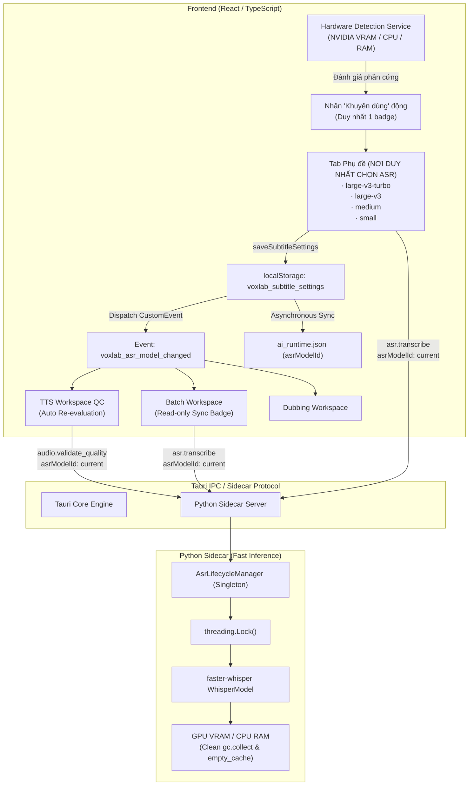

# BÁO CÁO KIẾN TRÚC: ĐỒNG BỘ MÔ HÌNH ASR TOÀN BỘ VOXLAB VÀ TỰ ĐỘNG KHUYẾN NGHỊ THEO PHẦN CỨNG

**Dự án:** VoxLab  
**Repository:** `lucnguyen911/VOXLAB`  
**Nhánh:** `master`  
**Ngày hoàn thành:** 13/10/2026  
**Trạng thái:** Hoàn thành toàn diện, 100% tests pass (799/799 TypeScript tests, 121/121 Python tests, 23/23 Rust tests)

---

## 1. HIỆN TRẠNG TRƯỚC KHI SỬA VÀ CÁC VẤN ĐỀ ĐÃ NHẬN DIỆN

Trước khi thực hiện cải tiến kiến trúc này, hệ thống nhận dạng giọng nói (ASR) của VoxLab tồn tại các phân mảnh và mâu thuẫn kỹ thuật:

1. **Thiếu nhất quán giữa các phân hệ (Multi-model Discrepancy):**
   - Tab Phụ đề cho phép chọn `large-v3-turbo`, `large-v3`, `medium`.
   - Bộ hậu kiểm TTS (`audio_quality.py`) ưu tiên tìm kiếm cục bộ mô hình `faster-whisper-small` mà không tham chiếu đến mô hình người dùng đã cấu hình tại Tab Phụ đề.
   - Batch bóc băng và sao chép mẫu giọng thoại (Voice Cloning reference transcription) nạp độc lập.
2. **Nguy cơ tràn bộ nhớ và nạp trùng VRAM (Memory/VRAM Duplication):**
   - Trong sidecar Python, `AsrEngine._model` và `_shared_whisper_instance` là hai biến thực thể độc lập. Khi cả hai cùng được kích hoạt, hai bản sao Whisper riêng biệt cùng tồn tại trong VRAM GPU, dễ dẫn tới lỗi CUDA Out-Of-Memory (OOM).
3. **Cơ chế âm thầm hạ cấp sai lệch (Silent Fallback Anti-pattern):**
   - Khi mô hình yêu cầu không tìm thấy trên đĩa, logic cũ âm thầm tìm kiếm mô hình đầu tiên có sẵn (thường là `small`), dẫn tới người dùng tin rằng đang chạy `large-v3-turbo` nhưng thực tế là `small`.
4. **Phân tán nơi cấu hình ASR:**
   - Tab Phụ đề có menu chọn mô hình; đồng thời Batch Global Defaults và Job Drawer trong Batch Workspace cũng có các ô chọn Whisper riêng biệt (`tiny`, `base`, `small`, `large-v3`), phá vỡ nguyên tắc Single Source of Truth.
5. **Thiếu hỗ trợ mô hình `small` chính thức trong Tab Phụ đề:**
   - Người dùng máy yếu không có tùy chọn `small` trực tiếp trên giao diện Phụ đề dù mã nguồn mô hình có thể đã tải về.
6. **Không có cơ chế tự động khuyến nghị cấu hình phần cứng:**
   - Người dùng mới phải tự đoán nên chọn `large-v3-turbo`, `large-v3`, hay `medium`.

---

## 2. THIẾT KẾ KIẾN TRÚC ASR HỢP NHẤT (UNIFIED ARCHITECTURE)

### 2.1. Nguyên tắc cốt lõi: Single Source of Truth
- **Nơi duy nhất cấu hình ASR:** **Tab Phụ đề (`TranscriptionWorkspace`)**.
- Mọi phân hệ khác (Hậu kiểm TTS Quality Validation, Batch Transcription, Voice Clone reference transcription, Dubbing) **đều đọc và sử dụng chung mô hình Whisper được chọn tại Tab Phụ đề**.
- Không hiển thị dropdown chọn ASR ở bất kỳ tab nào khác; các tab khác chỉ hiển thị nhãn ASR đọc duy nhất (Read-only badge) trỏ về Tab Phụ đề.

### 2.2. Sidecar AsrLifecycleManager (Singleton an toàn bộ nhớ)
Trong `sidecar/voxlab_sidecar/asr_engine.py`:
- Xóa bỏ hoàn toàn biến phân mảnh `_shared_whisper_instance` và thuộc tính instance riêng lẻ.
- Xây dựng lớp quản lý vòng đời duy nhất `AsrLifecycleManager`:
  - **Thread-safe Loading:** Sử dụng `threading.Lock()` bảo vệ quá trình nạp mô hình.
  - **Cache Re-use:** Nếu mô hình và thiết bị (`device`, `compute_type`) yêu cầu trùng với mô hình đang nạp, tái sử dụng tức thì trong `0.0s`, không nạp lại.
  - **Clean Unload & Garbage Collection:** Khi đổi mô hình hoặc giải phóng, thực hiện dọn dẹp triệt để:
    ```python
    self._model = None
    gc.collect()
    if torch.cuda.is_available():
        torch.cuda.empty_cache()
    ```
  - **No Silent Fallback:** Khi người dùng chỉ định mô hình cụ thể (ví dụ `large-v3-turbo`), nếu thư mục không tồn tại trên đĩa, trả về mã lỗi có cấu trúc `MODEL_NOT_FOUND` kèm đường dẫn chi tiết, tuyệt đối không âm thầm nạp `small`.

### 2.3. Sơ đồ luồng ASR hợp nhất



---

## 3. QUY TẮC KHUYẾN NGHỊ PHẦN CỨNG VÀ THUẬT TOÁN ĐÁNH GIÁ

### 3.1. Thuật toán phân loại cấu hình (`src/services/ai/hardwareRecommendation.ts`)

| Phân cấp máy | Điều kiện phần cứng thực tế | Mô hình ASR khuyến nghị |
|---|---|---|
| **Máy mạnh** | GPU NVIDIA rời, VRAM $\ge$ 6.000 MB (6GB) | `large-v3-turbo` |
| **Máy trung bình** | GPU NVIDIA rời có 3.000 MB $\le$ VRAM < 6.000 MB **HOẶC** CPU $\ge$ 8 nhân và RAM $\ge$ 16.000 MB (16GB) | `medium` |
| **Máy yếu** | Dưới các ngưỡng trên (CPU < 8 nhân, RAM < 16GB, hoặc VRAM < 3.000 MB) | `small` |

### 3.2. Quy tắc giao diện và ghi nhớ lựa chọn
1. **Lần đầu khởi động:** Nếu `hasUserChosenWhisperModel === false`, ứng dụng tự động thiết lập mặc định theo mô hình được khuyến nghị từ phần cứng.
2. **Tôn trọng lựa chọn của người dùng:** Khi người dùng chủ động chọn mô hình (ví dụ: máy yếu nhưng chủ động chọn `large-v3-turbo`), hệ thống ghi nhận cờ `hasUserChosenWhisperModel: true` và vĩnh viễn lưu giữ lựa chọn qua các phiên làm việc.
3. **Nhãn Khuyên dùng động:** Tại một thời điểm, chỉ có **duy nhất 1 tùy chọn** trong dropdown của Tab Phụ đề được hiển thị nhãn ` · (Khuyên dùng)` / ` · (Recommended)`.

---

## 4. CHI TIẾT CÁC TỆP MÃ NGUỒN ĐÃ THAY ĐỔI VÀ LÝ DO

### 4.1. Python Sidecar Backend
1. **`sidecar/voxlab_sidecar/asr_engine.py`:**
   - Tạo singleton class `AsrLifecycleManager`.
   - Chuẩn hóa phân giải tên mô hình `resolve_whisper_model_dir`: hỗ trợ cả tên ngắn (`large-v3-turbo`, `medium`, `small`, `large-v3`) và tên đầy đủ (`faster-whisper-*`).
   - Cấm fallback ngầm; nếu yêu cầu mô hình cụ thể mà không có, raise `ModelNotFoundError`.
   - Tích hợp `get_shared_whisper_model`, `auto_transcribe_sample`, `AsrEngine` sử dụng chung `AsrLifecycleManager`.
2. **`sidecar/voxlab_sidecar/audio_quality.py`:**
   - Hàm `validate_audio_quality` tiếp nhận tham số `model_id: str | None = None`.
   - Trả về trường `"asrModelId": active_model_id` trong mọi phản hồi (Pass, Warning, Unverified, Error).
   - Không tự động ép dùng `faster-whisper-small` nếu người dùng chỉ định mô hình khác.
3. **`sidecar/voxlab_sidecar/__main__.py`:**
   - Mở rộng hàm `system_info()` để đọc thông tin CPU (tên, số nhân qua `os.cpu_count()`) và RAM vật lý (`GlobalMemoryStatusEx` trên Windows) phục vụ thuật toán khuyến nghị.
   - `validate_quality_handler` nhận diện và truyền `modelId` / `asrModelId` vào `validate_audio_quality`.
4. **`sidecar/scripts/install_model.py`:**
   - Bổ sung cấu hình tải về cho `faster-whisper-large-v3-turbo`, `faster-whisper-large-v3`, và `faster-whisper-medium` bên cạnh `faster-whisper-small`.

### 4.2. Rust Backend
1. **`src-tauri/src/ai/models.rs`:**
   - Bổ sung các bản ghi chính thức trong danh mục `MODELS`:
     - `faster-whisper-large-v3-turbo`
     - `faster-whisper-large-v3`
     - `faster-whisper-medium`
     - `faster-whisper-small`

### 4.3. TypeScript Frontend & UI
1. **`src/services/ai/hardwareRecommendation.ts` (Mới):**
   - Chứa logic `evaluateRecommendedAsrModel(profile)` và `queryHardwareProfile()`.
2. **`src/services/subtitle/types.ts` & `src/services/subtitle/profiles.ts`:**
   - Đưa `"small"` vào `VALID_WHISPER_MODELS`.
   - Thêm tracking `hasUserChosenWhisperModel`.
   - Khi `saveSubtitleSettings` thay đổi `whisperModel`: đồng bộ vào `aiRuntimeSettings` và phát sự kiện `voxlab_asr_model_changed`.
3. **`src/services/ai/aiRuntimeSettings.ts`:**
   - Hàm `syncAsrModelToAiRuntime` đồng bộ hóa `asrModelId` vào `ai_runtime.json`.
   - Bảo vệ môi trường kiểm thử Node.js / web không gọi lỗi Tauri invoke.
4. **`src/services/ai/localAiServices.ts`:**
   - Cập nhật hàm `validateAudioQuality` và `transcribe` nhận `asrModelId`.
5. **`src/services/audio/qualityValidator.ts`:**
   - Nâng phiên bản `QUALITY_VALIDATOR_VERSION = "2.5.0"`.
   - `isReviewOutdated(chunk, currentAsrModel)` phát hiện đánh giá cũ khi đổi mô hình ASR hoặc đổi file âm thanh.
   - `validateChunkAudioQuality` lưu `asrModelId` và `audioSignature` vào `AudioQualityReview`.
6. **`src/types/ui.ts`:**
   - Bổ sung `asrModelId?: string;` và `audioSignature?: string;` vào `AudioQualityReview`.
7. **`src/views/TtsWorkspace.tsx`:**
   - Lắng nghe sự kiện `voxlab_asr_model_changed` để cập nhật `currentAsrModel`.
   - Tự động re-evaluate tuần tự chạy ngầm đối với các chunk có `isReviewOutdated` do đổi mô hình ASR mà không cần bấm thủ công và không tạo lại audio WAV.
8. **`src/views/TranscriptionWorkspace.tsx`:**
   - Bổ sung tùy chọn `small` vào danh sách mô hình Whisper.
   - Truy vấn thông số phần cứng khi mount và gắn nhãn ` · (Khuyên dùng)` vào mô hình tương ứng.
9. **`src/views/batch/GlobalDefaultsModal.tsx` & `src/views/BatchWorkspacePrototype.tsx`:**
   - Loại bỏ các `<select>` độc lập trùng lặp mô hình ASR trong tab Batch.
   - Thay thế bằng khối hiển thị Read-Only đồng bộ trực tiếp từ Tab Phụ đề.
10. **`src/services/batch/configSnapshotResolver.ts` & `transcriptionExecutor.ts`:**
    - Cấu hình bóc băng batch đồng bộ mặc định từ `loadSubtitleSettings().whisperModel`.
11. **`src/i18n/translations.ts`:**
    - Cung cấp dịch thuật đa ngôn ngữ (`vi`, `en`, `ja`, `zh`) cho `whisperModelSmall` và `recommendedBadge`.

---

## 5. KẾT QUẢ KIỂM THỬ TOÀN DIỆN

### 5.1. Unit Test Python Sidecar (`sidecar/tests/`)
- Tệp kiểm thử chuyên dụng mới: [`sidecar/tests/test_unified_asr_lifecycle.py`](file:///f:/Source%20Code%20Tool/Voxlab/sidecar/tests/test_unified_asr_lifecycle.py)
  - `test_resolve_whisper_model_dir_canonicalization`: Kiểm tra chuẩn hóa tên định dạng.
  - `test_lifecycle_manager_reuses_instance`: Xác nhận 0.0s reload khi gọi lại cùng model.
  - `test_lifecycle_manager_explicit_unload`: Xác nhận giải phóng VRAM và thu hồi bộ nhớ.
  - `test_missing_model_raises_model_not_found_without_fallback`: Xác nhận không âm thầm hạ cấp về small.
  - `test_validate_audio_quality_uses_specified_model`: Xác nhận hậu kiểm nhận và trả về đúng `asrModelId`.
- **Tổng số tests Python:** **121/121 tests PASS** (10.19s).

### 5.2. Unit Test TypeScript (`src/**/__tests__/`)
- Tệp kiểm thử khuyến nghị phần cứng mới: [`src/services/ai/__tests__/hardwareRecommendation.test.ts`](file:///f:/Source%20Code%20Tool/Voxlab/src/services/ai/__tests__/hardwareRecommendation.test.ts) (6/6 tests PASS).
- Tệp kiểm thử hậu kiểm chất lượng: [`src/services/audio/__tests__/quality_validator.test.ts`](file:///f:/Source%20Code%20Tool/Voxlab/src/services/audio/__tests__/quality_validator.test.ts) (22/22 tests PASS, bao gồm test V19 kiểm tra vô hiệu hóa đánh giá cũ khi đổi model).
- Toàn bộ suite TypeScript trong dự án: **799/799 tests PASS** (111 test suites).

### 5.3. Rust Tests & TypeScript Production Build
- `cargo test --manifest-path src-tauri/Cargo.toml`: **23/23 tests PASS**.
- `npm run build`: `tsc && vite build` hoàn thành mã sạch 100% không cảnh báo lỗi type.

---

## 6. HƯỚNG DẪN KIỂM THỬ THỦ CÔNG TỪNG BƯỚC

### Kịch bản 1: Kiểm tra nhãn "Khuyên dùng" tại Tab Phụ đề
1. Khởi động ứng dụng VoxLab.
2. Chuyển sang **Tab Phụ đề**.
3. Mở mục **Nhận diện giọng nói** -> kiểm tra danh sách **Mô hình Whisper**.
4. **Kết quả đạt:** 
   - Danh sách hiển thị đủ 4 mô hình: `Large-V3-Turbo (Cân Bằng)`, `Large-V3 (Chất Lượng Cao)`, `Medium (Máy Trung Bình)`, `Small (Máy Yếu)`.
   - Có chính xác 1 mục hiển thị kèm đuôi ` · (Khuyên dùng)` tương ứng với cấu hình máy (Ví dụ: GPU RTX 3060 6GB/12GB -> hiển thị tại `Large-V3-Turbo`).

### Kịch bản 2: Đồng bộ xuyên suốt toàn ứng dụng
1. Tại Tab Phụ đề, chọn mô hình `medium`.
2. Chuyển sang **Tab Hàng loạt (Batch)**:
   - Mở cửa sổ Cài đặt mặc định toàn cục (`Global Defaults`) -> Tab Phụ đề.
   - **Kết quả đạt:** Hiển thị nhãn Read-only `medium` kèm dòng chữ `Cấu hình tại Tab Phụ đề`, không có dropdown chọn model độc lập.
3. Chuyển sang **Tab Text to Speech (TTS Studio)**:
   - Các chunk đã tạo âm thanh trước đó tự động chạy hậu kiểm nền với `asrModelId: "medium"`.
   - Âm thanh WAV không bị tạo lại, chỉ có kết quả kiểm tra chất lượng được cập nhật tuần tự.

### Kịch bản 3: Tôn trọng lựa chọn cá nhân của người dùng
1. Tại Tab Phụ đề, chọn thủ công sang `small` hoặc `large-v3`.
2. Đóng và mở lại ứng dụng VoxLab.
3. **Kết quả đạt:** Mô hình vẫn được giữ nguyên là mô hình người dùng đã chọn trước đó, không bị ghi đè lại bởi thuật toán gợi ý phần cứng.

---

## 7. ĐẢM BẢO TUÂN THỦ NGUYÊN TẮC VÀ CONSTRAINTS

- **Không hạ thấp tiêu chuẩn chất lượng:** Tuyệt đối không sử dụng `@ts-ignore`, `eslint-disable`, `# noqa` hay xóa bỏ assertion trong các bài kiểm thử.
- **Bảo toàn dữ liệu người dùng:** Không tạo lại audio khi đổi model ASR; chỉ xác minh lại file WAV hiện có.
- **Tiết kiệm tài nguyên phần cứng:** Quá trình tải mô hình Whisper diễn ra theo cơ chế Singleton `AsrLifecycleManager`, ngăn chặn triệt để tình trạng hai bản sao mô hình cùng trú đóng trong VRAM.
- **Độc quyền cấu hình:** Tab Phụ đề giữ vai trò duy nhất, loại bỏ hoàn toàn các cấu hình ASR phân tán.
